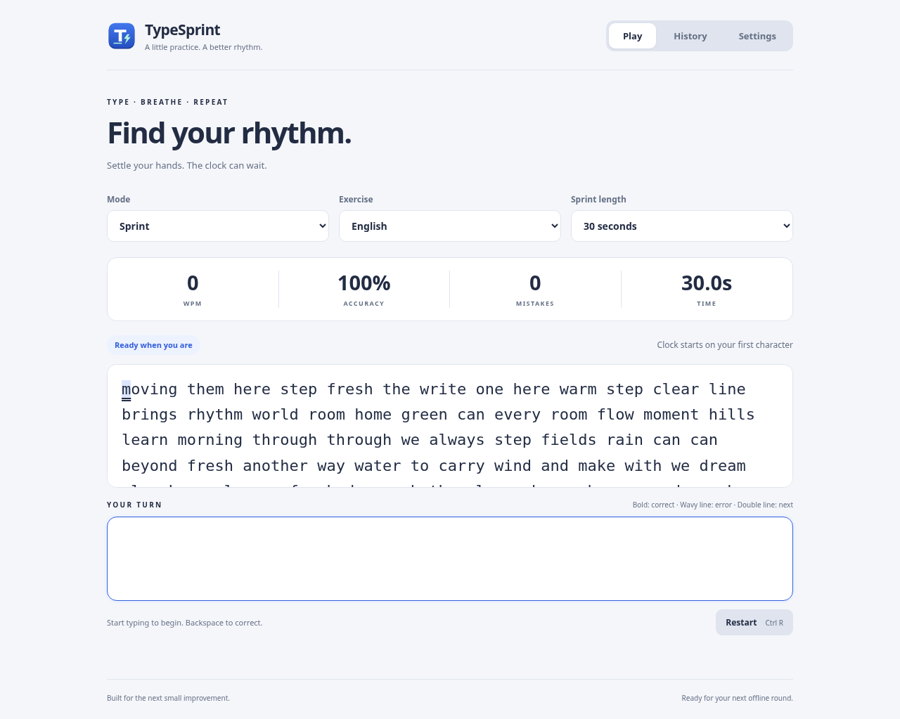

<div align="center">
  
  <h1>TypeSprint</h1>
  <p><strong>A little practice. A better rhythm.</strong></p>
  <p>A fast typing game for GNOME and the browser. Three modes, immediate feedback, and a fresh start one shortcut away.</p>
</div>



## Play online

**[Play TypeSprint in your browser](https://wahed126.github.io/TypeSprint/web/)** — no installation or account needed.

The [main site address](https://wahed126.github.io/TypeSprint/) opens the game automatically. The README remains documentation on GitHub.

## Overview

TypeSprint has two independently runnable versions in this repository:

| Version | Source | Stack | History and settings |
| --- | --- | --- | --- |
| Ubuntu desktop | `typesprint/` | Python 3, GTK 4, libadwaita, PyGObject | Local SQLite database |
| Browser | `web/` | HTML, CSS, JavaScript modules | This browser's localStorage |

Both versions include English and German exercises, Python and TypeScript code
practice, accurate scoring, personal bests, results, History, and text-size
settings. No accounts, analytics, remote exercise services, or paid APIs are
required. The versions share the same bundled exercise content and scoring
rules; their histories do not sync.

## Game modes

| Mode | Rules | Exercises |
| --- | --- | --- |
| **Sprint** | Choose 15, 30, or 60 seconds. The first character starts the timer. The word supply grows as needed. | English or German words |
| **Practice** | Untimed. Enter the passage's character count to finish; errors are allowed and reflected in your score. | English, German, Python, or TypeScript |
| **Survival** | Start with 30 seconds. A correct word **and its following space** earn one extra second, once per word position. | English or German words |

The reference highlights the current character, marks correct entries in bold,
and uses a wavy underline and color for mistakes. The active reference line stays
visible in a fixed-height viewport. Corrected mistakes remain in session stats.
Code preserves indentation, punctuation, and line breaks.

## Ubuntu desktop: install and run

Tested on **Ubuntu 26.04 LTS**. Install the distribution's Python bindings; there
are no pip runtime dependencies:

```bash
sudo apt update
sudo apt install python3 python3-gi gir1.2-gtk-4.0 gir1.2-adw-1 adwaita-icon-theme
```

From the repository root:

```bash
/usr/bin/python3 -m typesprint
```

Use `/usr/bin/python3` so Ubuntu's PyGObject bindings are available. A virtualenv
or alternate Python installation may not see system GTK packages. Launch from a
normal graphical desktop session. The input field has focus immediately.

### Install from a CI-built `.deb`

In the repository's **Actions** tab, open a successful **Build and test** run and
download the `typesprint-desktop` artifact. Extract the artifact ZIP, then run in
that extracted directory:

```bash
sha256sum -c SHA256SUMS
sudo apt install ./typesprint_1.0.0_all.deb
typesprint
```

`apt` installs the declared runtime dependencies. The package installs a native
launcher, icon, and application sources under `/usr/share/typesprint`. To remove
it while keeping your history:

```bash
sudo apt remove typesprint
```

### Add a source checkout to the app menu

Alternatively, run this from the repository root without sudo:

```bash
/usr/bin/python3 scripts/install-desktop.py
```

Open **TypeSprint** from GNOME's app grid, or run:

```bash
"$HOME/.local/bin/typesprint"
```

This creates a user launcher in `~/.local/bin/`, an icon in the local hicolor
icon theme, and a `.desktop` file under
`${XDG_DATA_HOME:-$HOME/.local/share}/applications/`. The launcher records the
checkout's absolute path, including paths containing spaces. Keep the checkout
in place, and rerun the installer after moving it. A source checkout installation
and a `.deb` installation are alternatives; remove the user launcher if you
switch to the package, so it does not shadow `/usr/bin/typesprint`.

To remove the source-checkout menu installation:

```bash
rm -f "$HOME/.local/bin/typesprint"
rm -f "${XDG_DATA_HOME:-$HOME/.local/share}/applications/io.github.typesprint.TypeSprint.desktop"
rm -f "${XDG_DATA_HOME:-$HOME/.local/share}/icons/hicolor/scalable/apps/io.github.typesprint.TypeSprint.svg"
```

The installer supports `--prefix /tmp/typesprint-install` for a disposable test.

## Browser version

The browser game is self-contained in [`web/`](web/README.md). It has no runtime
npm dependencies, backend, or external fonts. You need **Node.js 22+** to build,
and Python 3 for the example local server. From the repository root:

```bash
cd web
npm run build
npm start
```

Open **http://127.0.0.1:4173**. The build command uses Node's standard library and
does not require `npm install`. Serve over HTTP; opening `index.html` as a
`file://` URL cannot load the exercise module/data reliably.

For browser tests and development dependencies:

```bash
cd web
npm ci
npm test
npx playwright install --with-deps chromium
npm run test:browser
```

`web/dist/` is the standalone deployable static site. It uses relative URLs and works under a
GitHub Pages repository subpath. It includes a service worker: after the first
complete visit over HTTPS or localhost, the app can load and play offline. The
desktop version is offline from its first launch; the web version needs that
initial visit. Service-worker updates become available after old tabs close.

### Host on GitHub Pages

For the existing TypeSprint site, share **https://wahed126.github.io/TypeSprint/web/**.
The repository-root `index.html` opens the game when Pages publishes from `main`
and `/(root)`. The root `.nojekyll` keeps JavaScript and bundled exercises intact.
This path supports play and offline caching without a separate build step on
GitHub. Run `npm run build` in `web/` before committing changed game assets so
its generated service worker stays current; CI checks this.

Alternatively, publish only the standalone build using the custom workflow:

1. Publish this repository to GitHub with `main` as its default branch.
2. In **Settings → Pages → Build and deployment**, select **GitHub Actions** as
   the source.
3. Open **Actions → Deploy web to GitHub Pages → Run workflow**, selecting `main`.
4. After the workflow succeeds, open the deployment URL shown in its summary.

The Pages workflow is intentionally manual; regular CI builds both versions on
every push and pull request. Pages availability depends on your repository
visibility and GitHub plan. Follow [GitHub's custom Pages workflow guide](https://docs.github.com/en/pages/getting-started-with-github-pages/using-custom-workflows-with-github-pages)
for the repository setting. Other static hosts can serve `web/dist/` directly.

## Controls and accessibility

| Action | Desktop | Browser |
| --- | --- | --- |
| Start | Type the first character | Type the first character |
| Correct | Backspace, Delete, or selection replacement | Backspace, Delete, or selection replacement |
| Restart | Ctrl+R | Ctrl+R; Cmd+R also restarts on macOS |
| Navigate | Ctrl+1 / Ctrl+2 / Ctrl+3 for Play / History / Settings | Main navigation buttons |
| Move keyboard focus | Tab / Shift+Tab | Tab / Shift+Tab |
| Play again | Space or Enter on the focused/default button | Space or Enter on the focused button |
| Code indentation | Four literal spaces | Four literal spaces |
| Code newline | Enter | Enter |

The browser intercepts Ctrl+R for a fresh round. Use the browser toolbar's reload
button or Ctrl+Shift+R when you want a page refresh. Tab moves focus even during
code practice. Paste is accepted and every inserted character is an attempt.
Undo/redo are disabled so attempt history stays consistent.

Both interfaces follow the system's light/dark preference and support 16–36 px
typing text, visible keyboard focus, and normal Unicode text input, including
`ä`, `ö`, `ü`, and `ß`. Errors use underlines as well as color. The browser
respects reduced-motion preferences and exposes labeled controls and reference
text. The desktop uses native accessible GTK text widgets.

Changing the mode, category, or duration starts a fresh round. Leaving Play or
switching browser tabs **does not pause** the clock. Restarting discards an
unfinished round; a completed round is saved even when restart arrives before
the results callback.

## Scoring and personal bests

- **WPM** = correctly matched characters in the **final typed text** ÷ 5 ÷ elapsed
  minutes. Matching whitespace and punctuation count. Deleted correct characters
  no longer contribute. Zero elapsed time produces zero WPM; the live rate waits
  one second before displaying a useful sample.
- **Accuracy** = correct character-entry attempts ÷ all character-entry attempts
  × 100. Correcting a typo does not erase the original attempt. Backspace, Delete,
  arrows, modifiers, and other non-text keys do not count as character attempts.
- **Mistakes** = incorrect character-entry attempts, including corrected errors.
- **Personal best** = a strictly higher WPM in the same mode and category, with
  the same Sprint duration. Practice and Survival do not compare Sprint lengths.
  The first completed session establishes a best.

The clock is monotonic and starts with the first committed text. Input at or
after a deadline is rejected before scoring or awarding Survival bonuses. Late
UI callbacks preserve the exact deadline as the end time. In Survival, deleting
and retyping a word cannot earn its bonus twice; identical words at different
positions can each earn one bonus.

## Data and offline behavior

**Desktop:** completed sessions and settings are written immediately to SQLite:

```text
~/.local/share/typesprint/typesprint.sqlite3
```

When `XDG_DATA_HOME` is set, the path is
`$XDG_DATA_HOME/typesprint/typesprint.sqlite3`. Copy the database while the app is
closed to back it up. Unfinished rounds are not stored. Deleting the database
resets desktop history and settings.

**Browser:** settings and completed sessions are stored under the localStorage
key `typesprint.v1`, scoped to the site's origin. Clearing browser site data or
using a different browser/profile/origin changes the available history. Private
browsing, storage restrictions, or a full quota may prevent persistence; the app
shows a message and keeps the result in memory for the current visit. Desktop
SQLite history is never uploaded or read by the web version.

Exercises are authored and bundled in
`typesprint/data/exercises.json`. After editing them, synchronize the standalone
web copy and verify consistency:

```bash
/usr/bin/python3 scripts/sync-web-data.py
/usr/bin/python3 scripts/sync-web-data.py --check
```

## Tests

### Python rules, storage, and packaging

```bash
/usr/bin/python3 -m unittest tests.test_engine tests.test_storage -v
sudo apt install dpkg-dev
/usr/bin/python3 -m unittest tests.test_build -v
```

The tests use a controlled clock and temporary storage. They cover first-input
start, input at the deadline, corrections, final-text WPM, Unicode, Practice
whitespace, restart, Survival bonus deduplication, record grouping, and
persistence checked from a fresh process. Packaging tests inspect actual source
and `.deb` contents and exclude local state.

### GTK integration

In a graphical session:

```bash
TYPESPRINT_GUI_TESTS=1 /usr/bin/python3 -m unittest tests.test_gtk -v
```

For a headless Linux environment, install the display helpers and run as CI does:

```bash
sudo apt install xvfb xauth dbus-x11 fonts-dejavu-core
GSETTINGS_BACKEND=memory dbus-run-session -- xvfb-run -a \
  env GDK_BACKEND=x11 GSK_RENDERER=cairo GTK_A11Y=none \
  G_DEBUG=fatal-criticals PYTHONWARNINGS=ignore::DeprecationWarning \
  TYPESPRINT_GUI_TESTS=1 /usr/bin/python3 -m unittest discover -v
```

For an actual 15-second desktop round with isolated storage, focus checks,
optional screenshots, and History after a fresh-process UI relaunch:

```bash
GSETTINGS_BACKEND=memory /usr/bin/python3 scripts/check-desktop.py
```

The script drives GTK buffers and actions. It does not simulate physical keys.
GNOME may suspend rendering of an occluded window, so unavailable screenshots
are reported without skipping timing, layout, or persistence checks.

### Web engine and real-browser tests

```bash
cd web
npm test
npm ci
npx playwright install --with-deps chromium
npm run test:browser
```

Node tests cover the independent engine and storage. Playwright drives native
browser input, keyboard shortcuts, correction, full rounds, results focus,
history reload, composition events, code whitespace, responsive layouts,
settings, and offline service-worker loading. To use an existing Chromium/Chrome
installation instead of downloading Playwright's browser:

```bash
PLAYWRIGHT_CHROMIUM_EXECUTABLE_PATH=/path/to/chrome npm run test:browser
```

See [`VERIFICATION.md`](VERIFICATION.md) for checks actually performed and their
limits. Ordinary `python3 -m unittest discover -v` skips GTK tests unless
`TYPESPRINT_GUI_TESTS=1` is set.

## Build locally

From the repository root:

```bash
sudo apt install dpkg-dev
/usr/bin/python3 scripts/build-desktop.py
cd web
npm run build
```

Outputs:

| Output | Contents |
| --- | --- |
| `dist/typesprint_1.0.0_all.deb` | Architecture-independent Ubuntu package; system GTK remains a runtime dependency |
| `dist/typesprint-1.0.0-source.tar.gz` | Clean source distribution, including desktop, web, tests, and workflows |
| `dist/SHA256SUMS` | SHA-256 checksums for the desktop/source distributions |
| `web/dist/` | Standalone static browser game with content-versioned offline caching |

`--output /some/directory` selects another desktop build destination. Build
inputs are explicitly selected; Git internals, managed workspace directories,
node_modules, databases, local screenshots, logs, and previous build outputs
are excluded.

## Continuous integration

[`.github/workflows/ci.yml`](.github/workflows/ci.yml) runs on pushes, pull
requests, and manual dispatches:

- **Desktop job:** Ubuntu 26.04 container; installs native dependencies; checks
  exercises, Python compilation and the desktop file; runs all Python and GTK
  tests under Xvfb; builds `.deb`, source archive, and checksums.
- **Web job:** Node.js 22 with the committed lockfile; runs engine/storage and
  Chromium tests; builds the standalone site.
- Successful jobs upload **`typesprint-desktop`** and **`typesprint-web`**
  artifacts for 30 days. Failed browser runs upload diagnostics for seven days.

To download them, open **Actions → Build and test → a successful run → Artifacts**.
GitHub requires a signed-in account with repository access to download workflow
artifacts; see [GitHub's artifact download instructions](https://docs.github.com/en/actions/how-tos/manage-workflow-runs/download-workflow-artifacts).
CI does not automatically create a GitHub Release or publish to a package registry.

[`.github/workflows/pages.yml`](.github/workflows/pages.yml) is a separate,
manual deployment for the web build on `main`. Build CI has read-only repository
permissions. Pages deployment grants only its deploy job the Pages/OIDC
permissions required by GitHub.

## Publish the repository

If this directory is not already a Git checkout, create an empty GitHub
repository first, then run from the project root, replacing the URL with yours:

```bash
git init -b main
git add .gitignore .gitattributes README.md VERIFICATION.md CONTRIBUTING.md \
  typesprint tests scripts packaging web docs .github
git commit -m "Add TypeSprint desktop and web games with CI"
git remote add origin https://github.com/YOUR-ACCOUNT/TypeSprint.git
git push -u origin main
```

Authenticate Git with your normal GitHub CLI, credential helper, or SSH setup;
never put a token in this repository. The connected account or repository
permissions must allow creating `.github/workflows` files. Review staged files
before publishing, and use the verification commands above before merging
changes. The first push starts CI automatically when Actions is enabled.

## Project structure

```text
typesprint/                Python GTK app and independent game engine
  data/exercises.json      Canonical bundled exercises
web/                       Standalone browser version
  engine.js                DOM-independent game rules
  app.js                   Native browser input and interface
  storage.js               Browser-local history and settings
  data/                    Synced exercise bundle
  tests/                   Node and Playwright tests
  build.mjs                Dependency-free static build
scripts/                   Desktop installer, builds, and verification helpers
tests/                     Python rules, storage, package, and GTK tests
packaging/                 App icon and desktop launcher template
.github/workflows/         Build CI and optional GitHub Pages deployment
docs/                      Additional project documentation
```

## Troubleshooting

- **`No module named gi`:** install the Ubuntu packages and use
  `/usr/bin/python3`, not an isolated virtualenv interpreter.
- **No graphical display:** run the desktop app from GNOME, or use Xvfb for tests.
- **Menu launcher stops working after moving the checkout:** rerun
  `scripts/install-desktop.py` from its new location.
- **Web exercise load fails:** serve `web/dist/` over HTTP, and use the printed
  local URL rather than opening an HTML file directly.
- **Old web version after deployment:** close existing game tabs and reopen;
  the service worker waits until the previous app instance can be replaced.
- **Missing browser history:** verify the same origin/profile is in use and
  browser storage is permitted. Desktop and browser histories are independent.

## Contributing and license

See [`CONTRIBUTING.md`](CONTRIBUTING.md) for the development workflow. No
open-source license has been selected for this project yet; publishing the source
does not itself grant an open-source license. The owner can add a license before
accepting external contributions or redistributing the project.
